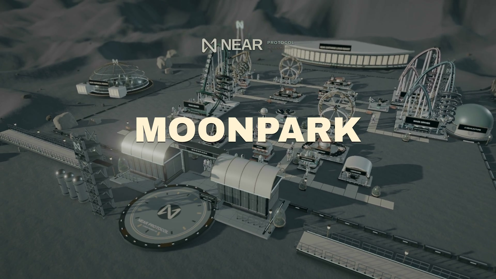

# MOONPARK — A NEAR Future

A lunar theme-park builder with hand-drawn roller coasters, rocket-borne visitors and autonomous businesses holding real NEAR testnet wallets.

[Play Moonpark](https://nearmoonpark.vercel.app) · [NEAR integration](docs/NEAR-ECONOMY.md) · [Verification](docs/MOONPARK-VERIFICATION.md) · [Submission preparation](docs/SUBMISSION.md)



One player designs the park. NPCs walk, queue, ride, spend finite budgets and form opinions. Illia's **Attention Kitchen** sells meals, Mert's **Finality Fizz** serves drinks and Haseeb's **Dragonfly Garage** maintains the rides. These are original fictional cameo characters.

## Try one complete loop

1. Choose **Open your park** for sponsored NEAR testnet play, or **Practice offline** for local play. The opening film is skippable. Optional **Continue with Google** sign-in enables account recovery across devices and eligible leaderboard play.
2. Start with **3,200 credits**, a connected kitchen, drinks stall and garage. The first rocket waits while you build your first coaster.
3. Choose **Mass-Driver Coaster**, click clear tiles for its station and drag a route across the actual park. Return to the golden connection or choose **Close loop to station**. Adjust a turn's height, colors, style and name, then build. The preview costs nothing until confirmed.
4. Watch the first rocket land. Visitors eat, drink and choose rides according to their budgets and preferences. Click the three faces on the right to inspect stock, business cash, customer counts and maintenance. The shop owners set prices, buy supplies and pay the park a fixed **10% share**.
5. Add a gentle ride for families or a taller **Lunar Bounce** for thrill-seekers. Choose its **8, 14 or 22 metre** tower before placement. Eight building types support multiple copies and three architectural styles. Draw paths with a drag, then release to build the connected stroke.
6. Click a coaster and choose its front-seat camera. Customize or redraw it for free. Buildings inside an irregular loop remain possible because the station and rail corridor reserve the occupied space. Raised rail sections allow walking paths underneath.
7. Open **My park and ride exchange**, publish your confirmed park and share its link. Another player can visit the published layout, ride its coaster and license an attributed, guest-tested design. A license pays **0.005 tNEAR**, with **90%** credited to its creator park's owner.

Scroll or pinch to zoom. Drag to pan while inspecting the park. During path or track drawing, use Space-drag, middle-drag or two fingers to pan. Camera movement is bounded. Dialogs, design tools and hidden tabs pause automatically. Ride fares and opening are automatic. Selling returns half the construction investment after current riders finish.

## Why NEAR belongs in the game

| Player experience | NEAR implementation |
| --- | --- |
| Shops operate without economic micromanagement | Separately created vendor accounts sign a fixed spending policy. NEP-245 credits and stock settle atomically with the simulation. |
| The park belongs to its player | A persistent registry records owner and authorized operator. An external testnet wallet claims ownership through signed acceptance. |
| Designs can be shared and earn creator income | The contract publishes guest-tested blueprints, verifies paid licenses, preserves attribution and backs creator withdrawals with actual license deposits. |
| Scores can be compared | A shared Rust engine runs in browser WASM and the keyless NEAR contract. Players send commands. The contract calculates outcomes and scores. |
| Play starts without wallet friction | Browser-generated accounts, restricted session keys and sponsored testnet gas keep signing out of the building loop. |
| A player can return on another device | Google-linked recovery credentials are encrypted in Neon Postgres. The confirmed park is fetched from NEAR and the local operation journal survives refresh. |

The merchants follow deterministic policies in [catalog.rs](crates/moon-sim/src/catalog.rs) and [lib.rs](crates/moon-sim/src/lib.rs). They adapt prices to inventory and demand, restock and pay operating expenses. Visitors have individual simulated budgets inside the contract's passenger escrow. The two merchants hold credits and stock in separately created NEAR accounts. Maintenance is an automatic park service.

The first **12 rockets / 96 visitors** determine a sealed opening score. Later guests fund continued building while that score stays fixed. The leaderboard and conditional giveaway use the current finished ruleset. Earlier parks retain their saved state and ownership through the account archive.

All gameplay funding uses free NEAR testnet assets. Game credits and inventory have no redemption value. The separate **0.5 tNEAR** escrow demonstrates frozen prize allocation. The creator's **US$1,000 track-win / US$5,000 grand-prize pledge** is conditional and unfunded. Its terms are visible in the game. Anonymous exhibitions appear separately from eligible signed-in results.

## Run locally

Requirements are Node **22.22.2+**, npm and a WebGL-capable browser. Checked-in WASM lets a fresh clone run practice with no secrets or Rust installation.

```sh
npm ci
npm run dev
```

Open **http://localhost:5173**, choose **Practice offline**, skip or watch the intro and draw a coaster. Hosted sponsorship and cross-device recovery use private server configuration. The local practice game remains available without it.

For simulation and contract development, use Rust **1.98.1** with `wasm32-unknown-unknown` installed.

```sh
rustup target add wasm32-unknown-unknown
npm run test:economy
npm run test:contract
npm run build:engine
npm run test:parity
npm run test:sandbox
npm run typecheck
```

With the dev server running, run `npm run test:game`. Browser tests use `/usr/bin/chromium`. Set `CHROMIUM_PATH` for another installation. `MOON_CAPTURE_GPU=1` enables the hardware-rendering flags used for visual checks. Optional `MOON_CHAIN_UI=1` checks spend free testnet sponsorship. `npm run build` creates the production Next.js application.

## Repository map

| Location | Contents |
| --- | --- |
| `app/moon-game.tsx`, `app/components/` | Player interface, map workshop, staff status, ownership and sharing |
| `lib/moon/world.ts`, `rides.ts`, `shops.ts`, `terrain.ts`, `spacecraft.ts` | Editable Three.js world, attractions and scenery |
| `crates/moon-sim/` | Deterministic economy, visitors, pathfinding and geometry validation |
| `crates/moon-contract/` | NEAR ownership, NEP-245 clearing, blueprint licensing and standings |
| `app/api/moon/`, `lib/moon/cloud-vault.ts` | Sponsored account provisioning, verified identity and encrypted recovery |
| `scripts/game/`, `tests/` | Replays, WASM builds, contract deployment, Sandbox and browser checks |
| `public/moon-config.json`, `public/moon-build.json` | Public contract address, code hash and exact build commitments |

## Hosting and testnet deployment

The live app uses Vercel, Neon Postgres and Neon Auth. Copy the empty names in [.env.example](.env.example) into a private `.env.local` for your own infrastructure. Keep its encryption key stable for recovery. Apply the database schema with `npm run db:migrate`. Hosted deployment details are in [GOOGLE-AUTH.md](docs/GOOGLE-AUTH.md) and [MOONPARK.md](docs/MOONPARK.md).

```sh
npm run deploy:testnet
npm run test:chain
```

Deployment creates a free-faucet-funded sponsor, a keyless child contract and restricted vendor policy accounts. It writes public configuration and ignored `.near-local/` credentials. New contract behavior requires a separate immutable deployment. `npm run deploy:testnet -- --open` opens eligible scoring after verification. Earlier contract configurations and engines remain checked in for recovery. Source contains public account addresses and test receipts. Private credentials, authenticated recovery records and local player journals are excluded from Git.

## Hackathon scope and credits

Built for **NEAR HACKATHON — Games With Real Economies** during November 2026. The history starts November 5. The earlier Mars prototype in this repository is part of the same project's development history and remains at `/legacy`.

Original gameplay, deterministic simulation, UI, procedural models, camera animation and sound design were developed with Codex assistance. Cameo illustrations use built-in ImageGen, with [saved prompts](docs/cameo-portrait-prompts.json). Dependencies include Next.js, React, Three.js, near-api-js, near-sdk, NEAR Connect, Neon and Vercel. Licensed music, narration production, NASA sky data, Earth maps and CC0 regolith/rock assets are credited in [VISUALS.md](docs/VISUALS.md) and [MOONPARK-CINEMA.md](docs/MOONPARK-CINEMA.md). The opening film is a recorded resort sequence. Live construction and customization use editable models.

[MIT license](LICENSE). Public repository preparation is complete independently of the final demo post and hackathon submission. Submission materials remain drafts until the owner reviews them.
